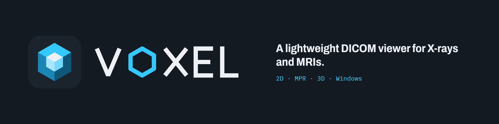
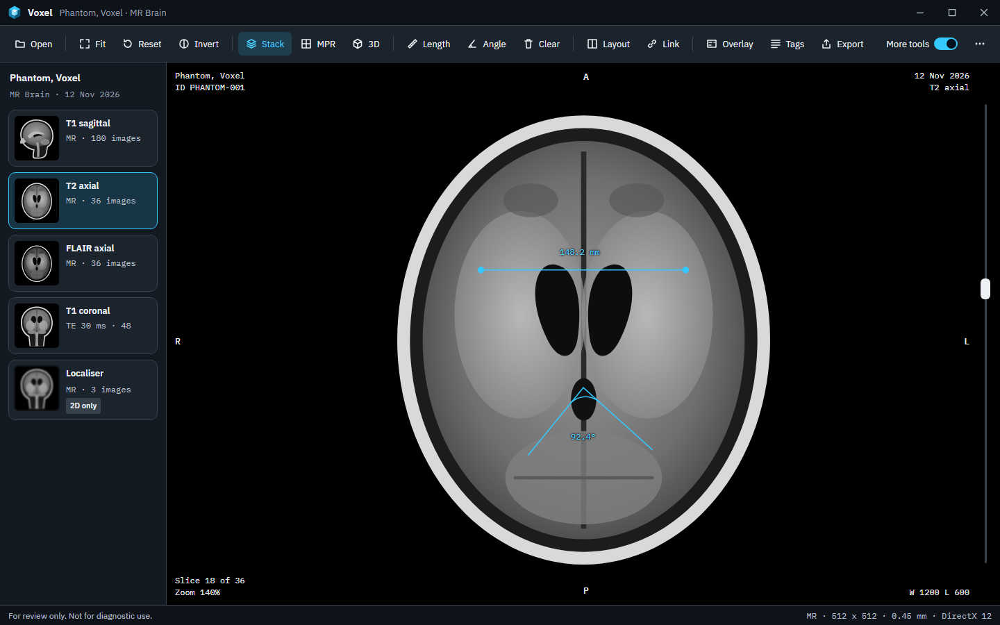
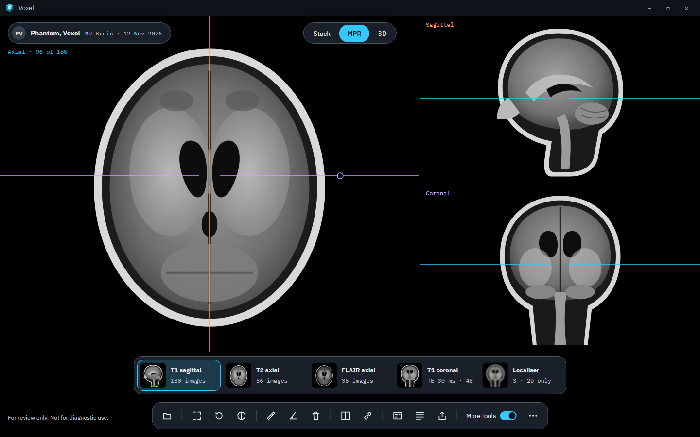
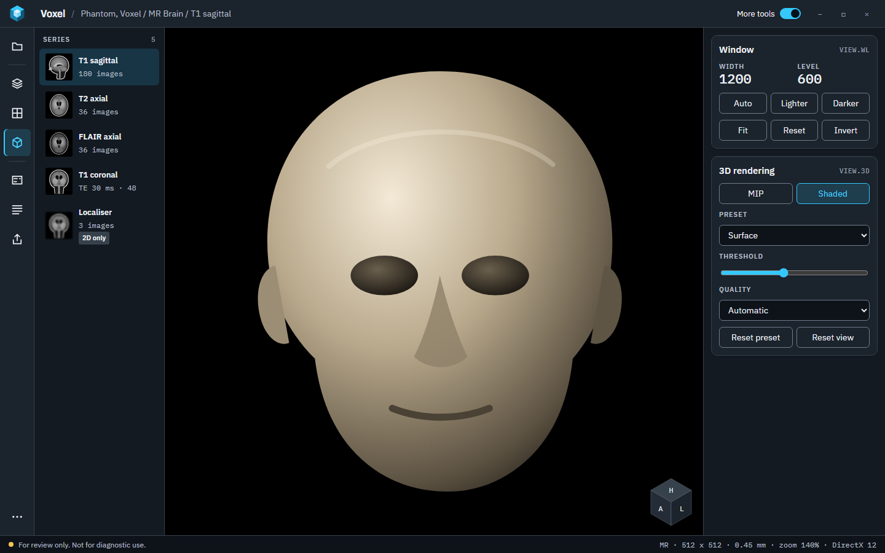

  <picture>
    <source media="(prefers-color-scheme: dark)" srcset="assets/brand/banner-dark.png">
    <source media="(prefers-color-scheme: light)" srcset="assets/brand/banner-light.png">
    
  </picture>

  
  
  
  
  

  <a href="#what-is-voxel">What it is</a> ·
  <a href="#where-does-the-project-stand">Status</a> ·
  <a href="#what-will-voxel-do">Features</a> ·
  <a href="#which-interface-do-you-get">Interfaces</a> ·
  <a href="#how-is-voxel-built">Tech stack</a> ·
  <a href="#what-is-the-plan">Roadmap</a>

## What is Voxel?

Voxel is a lightweight DICOM viewer for X-rays and MRIs on Windows. You double-click a scan and it opens: no PACS server, no database and no account. It is one small native program, written in Rust and drawn on the GPU.

It is made for two kinds of people. A patient who was handed a disc wants to see the image, scroll through it and make it brighter. A clinician wants measurements, side-by-side series, multi-planar reconstruction (MPR) and a 3D view. Voxel starts simple and shows the clinical tools when you turn on "More tools".

> **For review only. Not for diagnostic use.** Voxel is not a certified medical device.

## Where does the project stand?

Voxel is designed and planned, and the code is not written yet. This repository holds everything the build follows:

| What | Where | State |
| ---- | ----- | ----- |
| Tech stack, targets and risks | [docs/plans/2026-11-17-voxel-tech-stack.md](docs/plans/2026-11-17-voxel-tech-stack.md) | Decided |
| Brand | [assets/brand/](assets/brand/) | Final |
| Interface design: 3 interfaces, 15 screens each | [design/SPEC.md](design/SPEC.md) | Approved |
| Build plan: 49 sections in 7 phases | [todo/implementation-plan.md](todo/implementation-plan.md) | Ready to run |
| Application | `src/` | Not started |

There is nothing to download yet. The pictures below are the approved designs, drawn with synthetic phantom images, not screenshots of a running program.

## What will Voxel do?

- **Open fast.** The target is under one second from double-click to the first image for a typical X-ray, measured by a script in the plan.
- **Show X-rays properly.** The full 16-bit image goes to the GPU, so brightness and contrast change instantly and no detail is thrown away.
- **Scroll MRI series.** The first slice shows at once and the rest load behind it. A series strip lists every series in the study.
- **Reconstruct other planes (MPR).** Axial, coronal and sagittal views with linked crosshairs, and any oblique angle.
- **Render in 3D.** Maximum intensity projection and shaded volume rendering, with a quality setting for PCs without a real GPU.
- **Measure.** Lengths in millimetres and angles, honest about accuracy: an X-ray length says "at detector", and an image without spacing reads in pixels.
- **Compare.** Two or four panes that scroll together by position in the patient.
- **Inspect.** A searchable browser of every DICOM tag.
- **Export.** The current view as a PNG, without patient details unless you ask for them.
- **Refuse clearly.** A file that is not DICOM gets one plain sentence, never a crash.

Version 1 leaves out a study database, PACS networking and reporting.

## Which interface do you get?

All three. Voxel ships three complete interfaces over the same functions. You choose one when you install it and can change it at any time in Settings, without restarting and without losing your place.

### Workstation (the default)

A toolbar on top and the series on the left: the layout radiology staff already know.

### Lightbox

The image fills the window. Tools float in a dock and series sit in a filmstrip.

### Console

An icon rail for the views, and an inspector that shows every setting and figure.

Every screen of every interface is in [design/screens/](design/screens/), and you can click through the designs by opening the pages in [design/prototype/](design/prototype/) in a browser.

## How is Voxel built?

| Layer | Choice | Why |
| ----- | ------ | --- |
| Language | Rust | Native speed, one static program, safe parsing of untrusted files |
| App shell | `eframe` (`winit`, `wgpu`, `egui`) | Starts fast, with little glue code |
| Graphics | DirectX 12, with the WARP software adapter as fallback | Runs on any Windows 10 or 11 PC, with or without a GPU |
| DICOM | `dicom-rs` with its codec features | Reads headers without decoding pixels; covers the common compressed formats |
| Rendering | WGSL shaders | Window/level, MPR sampling and ray marching all run on the GPU |
| Packaging | One portable exe, and a per-user installer | Runs from a disc; installs without administrator rights |

The reasons, the options that were rejected and the risks are in the [tech stack plan](docs/plans/2026-11-17-voxel-tech-stack.md).

## How do we know the app matches the design?

A test checks it. Each of the 45 designed screens has a picture and a contract file listing every control and every text with its label, shortcut, state, rectangle, colours and font. The app will describe what it drew in the same form, and a test compares the two within stated tolerances. The rules are in [design/SPEC.md](design/SPEC.md), under "What 1:1 means, and how it is proved".

## What is the plan?

The work is planned as small sections with checkable steps, in [todo/](todo/). Each section is reviewed by a second model family before it counts as done.

| Phase | What it delivers |
| ----- | ---------------- |
| 0 | Rust toolchain, pinned dependencies, an empty window, test files and phantoms |
| 1 | The first image: X-ray viewing, the theme, the three interface shells, the contract test |
| 2 | MRI series: folders, discs, stack scrolling, the series strip |
| 3 | Volumes and MPR |
| 4 | 3D rendering |
| 5 | Clinician tools: modes, measurements, layouts, tags, export, Settings |
| 6 | Release: the portable exe, the installer, file association, About |

## What is in this repository?

| Path | Holds |
| ---- | ----- |
| `assets/brand/` | The icon, wordmark, banners and social preview, with their sources |
| `design/` | The interface specification, tokens, prototypes, pictures and contract files |
| `docs/plans/` | The tech stack and build plan |
| `todo/` | The execution plan, one file per milestone |
| `scripts/` | Plan tooling, the render scripts and the campaign launcher |
| `AGENTS.md` | The working rules for the coding agents that build Voxel |

## Who makes Voxel?

Voxel is a [Rizonesoft](https://github.com/rizonesoft) project, started in November 2026. Questions and ideas are welcome as [issues](../../issues); see [CONTRIBUTING.md](CONTRIBUTING.md) first. To report a security problem, follow [SECURITY.md](SECURITY.md).

## Licence

Copyright Rizonesoft. All rights reserved until a licence is chosen; see [LICENSE](LICENSE). The fonts Voxel uses (Archivo, IBM Plex Sans and IBM Plex Mono) are under the SIL Open Font License.
